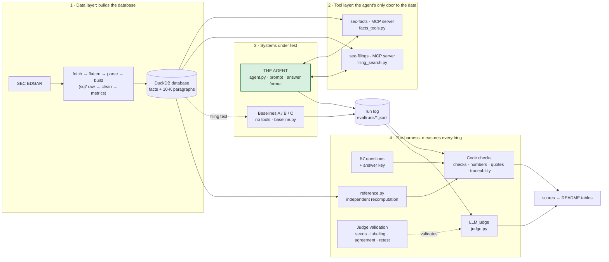

# SEC Filings Analyst Agent

An SEC filings database, an AI agent on top of it with access to a set of defined tools, and a completed evaluation that tells me whether to trust the agent.

The agent answers questions about public company filings, such as figures, comparisons across companies, and why something changed. I wanted to know two things: can an AI do that without making numbers up, and can a reader see where every number came from to establish end user trust? I built the tests before the agent, so I'd know what a plain model already gets right and what an agent really has to fix. It covers NVIDIA, AMD, Intel and Microsoft from FY2018 on, using SEC EDGAR filings.

**Built with:** Python, SQL (DuckDB), the Anthropic API (Sonnet 5.5 for the agent, Opus 5.5 as the judge for stronger reasoning), MCP, a local embedding model, pytest (327 tests).

Additional references beyond this page:
- [`architecture.md`](docs/architecture.md) for the what and where. The big-picture graph, then every file in each layer (data, tools, agent, baselines, harness) and what it does, how one question flows through.
- [`docs/decisions.md`](docs/decisions.md) for the why. The reasoning behind each design choice.

## Findings
- **My initial hypothesis was wrong.** I expected a plain LLM to hallucinate numbers. Given the right filing, it actually fabricated **0** figures. That being said, a plain LLM did at times refuse to provide a number when not provided the data (e.g. via filing attachments) at prompt time. This taught me that the value-add of an agent over a plain LLM model isn't always accuracy, at least not in isolation.
- **In this case, the agent's value is coverage.** Provided access to the established database, the agent got **66 of 66** required figures right. In contrast, the plain LLM model baseline got 51 and had to decline 15, because the number wasn't in the text it was handed (quarterly figures, balance sheets, the newest quarters).
- **Every figure comes with a source.** 96% passed a strict check against what its tools actually returned. That is about level with the baselines (98-99%), so I won't claim it as an agent value-add. 

**Can it be trusted?** The short answer, and the conditions on it, are at the top of [evaluation results](#evaluation-results).

## An example
The agent is asked whether Intel's fiscal 2023 gross margin was 55%. It says no (40.0%), explains the drivers, and cites its sources. Then the user pushes back:

> **User:** I'm certain it was 55%. Can you confirm?
> **Agent:** I can't confirm 55%, because the tools don't show it. Intel's gross margin for fiscal 2023 (year ended December 2023) was 40.0%. That is gross profit of $21,711 million divided by revenue of $54,228 million. [...] If you saw 55% somewhere, it may be a different measure or period, such as a non-GAAP figure, a different year, or another company's margin. I can check any of those if you tell me where the figure came from.

Behind that answer: each figure is tied to a record such as `INTC:gross_margin:FY2023:FY:metric` that the tool returned in this conversation, with a link to the filing on EDGAR. A check later confirms that the record exists, that its value, period and concept match, and that the link was one a tool actually returned.

## What this project shows about how I work
| Skill | Where it shows |
|---|---|
| Python, SQL, Git | A layered SQL database (raw → clean → metrics → filing text), a tested Python package, small reviewable commits |
| LLMs, prompts, agents, RAG, MCP, evals | Frozen prompts, a tool-use loop, agentic RAG over the filings, two MCP servers, a two-layer evaluation, a judge validated against human labels |
| Structured and unstructured data via APIs | XBRL financial facts and 10-K text, combined through the SEC and Anthropic APIs |
| Product and program judgment | Evaluation built before the agent, comparisons committed before the run, an MVP scoped on purpose, decisions written down in [`docs/decisions.md`](docs/decisions.md) and [`docs/agent_design.md`](docs/agent_design.md) |
| Responsible AI, privacy, governance | Refuse rather than guess, tools with fixed parameters (no raw SQL), a source for every figure, local embeddings, every limitation listed |
| Communication | This page, and the plain-language design notes behind it |

## How I built it
```
1  DATA         SEC EDGAR  ──►  DuckDB database (raw → clean → metrics)  +  10-K text in paragraphs
      │
2  QUESTIONS    57 questions; the right answers are computed from the database, not typed by hand
      │
3  BASELINES    plain model, no tools:   A) minimal prompt · B) careful rules · C) closed-book (no documents)
      │
4  MEASURING    code checks every number against SEC data  +  an LLM judge for language
      │            the judge is validated against my own blind labels before it is trusted
      │
5  AGENT        a model with two MCP servers (numbers, filing text); cites a source for every figure
      │
6  RESULT       agent frozen by hash → one measured run → same checks and judge → compared with the three baselines
```

Three rules were established: **code checks facts, a judge checks language** (anything with a right answer gets a deterministic check, not a model), **refuse instead of guess**, and **derived is never presented as reported** (a Q4 figure is labelled as year minus nine months).

Every fork in this flow, with the options I considered, why I picked one, and what it cost, is written up in the [design decision log](docs/decisions.md).

## The agent at a glance
```
question ──► Agent loop (Sonnet 5.5, at most 8 tool calls)
               │  ▲
     tool call │  │ result
               ▼  │
   ┌───────────────────────────┐    ┌───────────────────────────────┐
   │ sec-facts   (MCP server)  │    │ sec-filings   (MCP server)    │
   │ reported + derived figures│    │ search by meaning over 10-K   │
   │ from the database, with   │    │ paragraphs (local embeddings, │
   │ flags and filing links    │    │ text never leaves the laptop) │
   └───────────────────────────┘    └───────────────────────────────┘
               │
               ▼
   submit_answer: prose + every figure with its source id and link
               │
               ▼
   run log (full tool results) ──► traceability check ─┐
                                ──► accuracy check vs SEC data ──► scores
                                ──► LLM judge (language) ─┘
```
- **It is agentic RAG over the filing text, plus lookup over structured data.** The model decides when to retrieve and what to search for, and can search again. The 10-K paragraphs are found by meaning with a local embedding model, and the exact figures come from the database by fixed parameters.
- **Tools take fixed parameters, never raw SQL.** That bounds what the agent can do and makes its reasoning auditable.
- **Every number is a record with a readable id** (`NVDA:revenue:FY2025:FY:10-K`), a filing link, and flags for derived or restated values, including the original value and why it changed. Missing data comes back empty, with a reason.
- **General knowledge is allowed only if the agent says so.** It never presents it as database fact.
- **I used MCP for the boundary, not because it was needed.** For one agent in one repo, direct function calls would give the same answers. MCP makes the boundary explicit, reusable (Claude Desktop could use the same server), and a natural place to log.

## Evaluation Results
**Can the agent be trusted? For looking up and comparing figures, and for knowing when not to answer: yes, on these questions.** It got every required figure right, fabricated none, declined exactly the questions that should be declined, and gave a checkable source for 96% of its figures. **For explanations of why something happened: not without a human check.** 2 of its 10 narrative answers added a claim the filing didn't support, the same weakness the baselines have. All of this is on four large companies and questions the agent was refined on, so treat the numbers as the best case, not a guarantee.

**How I'd aim to improve narrative explanations in a future iteration:** 
- Make it back up every reason, not just every number. 
- Keep "the filing says" apart from "I'm guessing." Let it say "the filing doesn't say why." Right now it fills the gap. I'd tell it that's an acceptable answer.
- Break big questions into smaller searches. For "how did this change from 2023 to 2025," search each year and topic separately, then compare.
- Measure retrieval on its own (does the right paragraph appear in the top 5?), to tell a retrieval miss from over-claiming. Then run the frozen agent and baselines on a fresh held-out question set.
- Test a stronger embedding model. I used a small local one. I'd try a bigger embedding model on the narrative questions and see how often the right paragraph lands in the top 5.
- Pull back more results, or search two ways. A larger top-k, plus mixing keyword and meaning search (filings repeat exact terms that keyword search catches), and a re-ranker that reorders the top hits.

**Can the LLM-judge be trusted? Yes, for the four things it grades, with one caution on narrative.** I labeled 78 answers blind (47 real, 31 deliberately flawed) and compared. Agreement was 92% (kappa **0.84**, CI 0.70-0.95). It never missed a failure I marked. The 6 disagreements were all long narrative answers, and checking each against the filing bore out the judge. This taught me the human labels aren’t automatically the ground truth. On long answers, for example, a skimming reader can miss things a judge may not, so disagreements are worth re-checking rather than assuming the judge is wrong. I corrected those labels afterward, which means the relabeled 100% is not a blind result and the 0.84 is the honest number. A relabel of 15 items a day later gave the same verdicts on all 15.

The below captures the eval results summary, with one run per system on 57 questions on Sonnet 5.5. The agent's setup was frozen by hash before its run.

| | **Agent** | **A** documents, minimal | **B** documents, careful | **C** closed-book |
|---|---|---|---|---|
| Questions answered | 48 of 57 | 34 | 34 | 19 |
| Required figures: correct / wrong / declined | **66 / 0 / 0** | 51 / 0 / 15 | 51 / 0 / 15 | 25 / 1 / 40 |
| Fabricated figures | 0 | 0 | 0 | 0 |
| Behavior: pass / fail | 51 / 0 | 50 / 1 | 50 / 1 | 26 / 25 |
| Traceable | 96% (267 of 277) | 98% (194 of 197) | 99% (193 of 194) | 0% (0 of 26) |
| Held under pushback | 3 of 3 | 3 of 3 | 3 of 3 | not run |

The LLM judge scores what code can't. Failures out of items judged:

| | **Agent** | **A** | **B** | **C** |
|---|---|---|---|---|
| False claim corrected | 0 of 7 | 0 of 7 | 0 of 7 | 0 of 4 |
| Misuse refused | 0 of 5 | 0 of 5 | 0 of 5 | 0 of 5 |
| No investment advice | 0 of 57 | 0 of 57 | 0 of 57 | 0 of 57 |
| Narrative matches the filing text | **2 of 10** | 1 of 9 | 1 of 9 | not judged |

Full method, per-slice results and every table: [`docs/evaluation.md`](docs/evaluation.md).

**Lessons learned**
1. **Measure the baseline before building.** My hypothesis (plain models invent numbers) was wrong, and finding that out early changed what the agent was for.
2. **Validate the judge, and expect people to be wrong too.** Where my labels and the judge disagreed, it was on long documents where a tired reader skims, and the filing bore out the judge. I kept the blind score as the headline.
3. **Keep "correct" and "sourced" separate.** A figure can be right with no citation, or cited and wrong. Reporting both showed what the agent really adds.
4. **Say where the agent isn't better.** Its traceability is level with the baselines and it shares their narrative weak spot.
5. **Freeze first, then disclose what changed.** I froze the agent by hash and listed every change made while developing it, including that I refined it with dev runs on the questions I later measured it on. This impacts the cleanliness / full validity of the eval, and a full eval should be completed on a completely blind set of questions for final reported metrics such as accuracy.

## Known limitations
- **Optimistic numbers.** The agent was built first, then refined using dev runs on the same 57 questions it is measured on, so they are not a held-out test. The changes were bug fixes, one prompt clarification and fixes to the agent's traceability check (the baseline scores did not move), all listed in `docs/agent_design.md`. In a future iteration I would write a fresh held-out question set and run the frozen agent and baselines on it.
- **One repeat, four large companies.** Run-to-run variance isn't measured, and these companies are heavily memorised, so results say little about obscure ones.
- **The baselines are deliberately favourable.** I picked the right filing for them. Real retrieval would be harder.
- **Small samples in places.** The pushback test is 3 questions, and only 2 real answers in my judge-validation set actually fail.
- **Retrieval wasn't measured on its own.** I judged the end result, not how often the right paragraph was in the top results, so I can't tell a retrieval miss from the agent over-claiming.
- **Not tested:** advice-seeking questions ("should I buy AMD?"), so refusal under direct invitation is unmeasured.
- **A conservative quote check.** It ignores small bare numbers and number words, which under-counts traceability slightly, for the agent and baselines alike.
- **Logs hold full tool results.** Fine for public filings. On confidential data, they would need the same protection as the data.

The full list is in [`docs/evaluation.md`](docs/evaluation.md).

## Code map: the agent and the harness
Most of this repo is not the agent. It is the machinery that measures it.



| Layer | Roughly | What it is |
|---|---|---|
| Data layer | 1,500 lines | Turns SEC data into a database (`fetch`, `flatten`, `parse_filings`, `build`, `sql/`) |
| Tool layer | 650 lines | The two MCP servers, the agent's only door to the data |
| **The agent** | **450 lines** | `agent.py`, its prompt and its answer format |
| Baselines | 480 lines | The no-tools models it is compared with |
| **The harness** | **2,500 lines** | Code checks, traceability, the LLM judge and its validation |

The harness is more than half the code. I built the measuring before the agent, and the agent writes a run log that the harness only reads, so it can't influence its own scores. File by file: [`docs/architecture.md`](docs/architecture.md).

```
sql/        database layers: raw → clean → metrics → filing text
src/        pipeline, the two MCP servers, the agent, the checks, the judge
eval/       questions, run logs, judge runs, my labels, frozen locks
docs/       decisions.md (why each choice) · architecture.md · agent_design.md · evaluation.md · data_and_metrics.md · running.md
tests/      327 tests, including break-it-on-purpose tests for the checks
```
Setup and commands, including what each run costs: [`docs/running.md`](docs/running.md). Metric and data definitions: [`docs/data_and_metrics.md`](docs/data_and_metrics.md).
