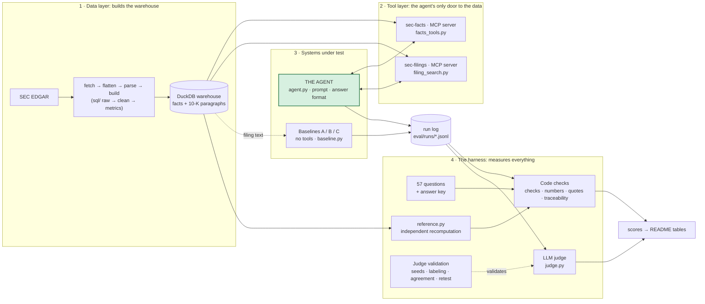

# Architecture: the agent and the harness

Most of this repo is not the agent. It is the machinery that measures the agent. The agent is about 450 lines; the harness that tests it is about 2,500. That follows from building the evaluation first.

## The big picture

The **run log** is the only link between the systems being tested and the harness. The agent writes it, and the harness only reads it, so the agent cannot influence how it is scored. The two MCP servers are the agent's only door to the data.

## 1. Data layer: turns SEC data into a warehouse
| File | What it does |
|---|---|
| `fetch.py` | Downloads each company's structured financial facts from SEC EDGAR and saves them untouched |
| `flatten.py` | Flattens that JSON into a table (the **raw** layer) |
| `fetch_filings.py` | Downloads each company's 10-K filings as HTML |
| `parse_filings.py`, `text.py` | Parses the HTML into paragraphs (Business, Risk Factors, MD&A) with stable ids |
| `sql/01_raw.sql` to `04_filing_text.sql` | The warehouse layers: raw → **clean** (latest filing wins, tag mapping, fiscal labels, derived Q4) → **metrics** (margins, growth) → filing text |
| `build.py` | Rebuilds the whole DuckDB file from scratch by running the SQL files in order |

## 2. Tool layer: what the agent can reach
| File | What it does |
|---|---|
| `facts_tools.py` | The logic for the numbers tools (`get_concept`, `compare_companies`, `get_metrics`, `list_available_periods`). Returns records with ids, filing links and flags, and returns empty with a reason when data is missing |
| `mcp_facts.py` | A thin wrapper that exposes those functions as an MCP server |
| `filing_search.py` | The logic for the text tools (`search_filing`, `get_paragraph`), using a local embedding model |
| `mcp_filings.py` | A thin wrapper exposing those as the second MCP server |

The servers hold no logic of their own, so the logic can be tested without running a server.

## 3. The agent
| File | What it does |
|---|---|
| `agent.py` | The agent itself. It starts both MCP servers, runs the loop (the model asks for a tool, the tool runs, the result goes back), enforces the 8-call limit, requires `submit_answer`, and writes the run log with the full text of every tool result. It also has the `--freeze` fingerprint check |
| `agent_prompts.py` | The system prompt (the eight rules) and the hash that covers prompt, answer format and tool definitions |
| `schemas.py` (the `Agent*` classes) | The structured answer: prose plus every figure with its source type, ids and link |
| `llm.py` (`create_with_tools`) | The one function that makes a model call with tools |

## 4. The baselines: what it is compared with
| File | What it does |
|---|---|
| `baseline.py` | Runs a model with no tools: question plus the right filing text, one structured answer |
| `prompts.py` | The A (minimal) and B (careful) prompts, plus closed-book C, hashed and frozen |
| `docs.py` | Picks which filing text each question gets |
| `schemas.py` (the `Answer` classes) | The baselines' answer format |

## 5. The harness: measures everything
**Questions and ground truth**
- `eval/questions.jsonl` has the 57 questions and the right answers.
- `reference.py` recomputes the answers from the warehouse in plain Python, independently of the SQL, so a bug in one cannot hide in the other.

**Code checks** (for anything with a right answer)
| File | What it does |
|---|---|
| `checks.py` | The orchestrator: scores every figure (correct, wrong, fabricated, misread and so on), required figures, refusals and pushback |
| `numbers.py` | The rounding rule, scale-slip detection, and a scanner for numbers in prose |
| `quotes.py` | Checks that a quote appears word for word in the source |
| `traceability.py` | The agent's source check: rebuilds what the tools actually returned from the log, and verifies each cited record, quote, link and calculation |

**The LLM judge** (for language that code cannot read)
| File | What it does |
|---|---|
| `judge_prompts.py` | The four rubrics and output formats |
| `judge.py` | Runs one judge call per criterion with three votes, and builds the agent's narrative source text from its logged tool results |

**Validating the judge**
| File | What it does |
|---|---|
| `seeds.py` | Writes deliberately flawed answers to test whether the judge catches them |
| `labeling.py` | Builds the blind labeling page and the answer key |
| `agreement.py` | Computes kappa, recall and the confusion matrix, judge versus my labels |
| `retest.py` | Builds the 15-item re-label that measures my own consistency |

## 6. Shared pieces and evidence
- `llm.py` is the only file that talks to the model provider (models, effort, prices, timeouts). The agent, the baselines and the judge all go through it.
- `eval/` holds the evidence: run logs, judge runs, my labels, and the lock files that freeze each setup.
- `tests/` holds 327 tests, including break-it-on-purpose tests for the checks.

## Workflow and boundaries
1. `agent.py` starts the servers and gives the model the question and the tool menu.
2. The model calls tools. `facts_tools.py` queries the warehouse, and `filing_search.py` searches the text.
3. The model calls `submit_answer`, and `agent.py` writes everything to the run log.
4. `checks.py` and `traceability.py` read that log and score each figure against the SEC data and the tool results.
5. `judge.py` reads the same log and scores the language.
6. The numbers go into the README tables.

- The only door from the agent to the data is the two MCP servers, which take fixed parameters and no raw SQL.
- The harness has its own independent route to the right answers (`reference.py`), so the agent and the checks cannot share a bug in the SQL.
